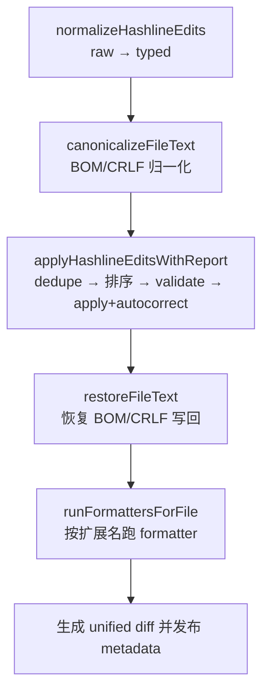
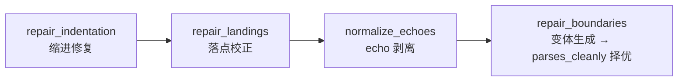

# Hashline Edit 技术调研报告

> 调研对象：oh-my-openagent (omo，commit `cd31c31b`) 与 oh-my-pi (omp，commit `b91db66e`) 的内容寻址编辑实现
> 目标：评估 ZooKeeper 引入 hashline 编辑的可行方案
> 日期：2026-10-14

---

## 一、问题背景

OpenCode 原生 `edit` 工具使用 `oldString/newString` 模式：LLM 提供要替换的原始文本片段，引擎在文件中查找匹配。这种方式有两个核心问题：

1. **行号漂移**：LLM 引用行号 N 时，前一次编辑插入或删除了行，行号 N 已指向不同内容。
2. **oldString 不匹配**：LLM 生成的 oldString 与文件实际内容有微小差异（缩进、空白、遗漏），导致 `oldString not found` 错误。

内容寻址编辑（hashline）的思路：给内容算哈希，让编辑指令携带哈希锚点。引擎先校验锚点再落笔，内容变了就拒绝并提供新锚点，绝不猜测。omo 和 omp 各自实现了一套，设计取径不同。

---

## 二、调研对象概览

| | omo | omp |
|---|---|---|
| 形态 | OpenCode 插件，shadow 内建 `edit` 工具 | 独立 agent CLI 的内建编辑引擎 |
| 哈希粒度 | 逐行（每行一个 2 字符 ID） | 整文件（每个文件一个 4 位 hex tag） |
| 实现语言 | 纯 TypeScript | Rust 核心 + NAPI 桥接 + TS 装配层 |
| 编辑格式 | JSON（`{op, pos, end, lines}`） | 文本 diff 风格（`PUT` + `+` 前缀 body） |

---

## 三、omo 方案：逐行哈希

### 3.1 架构

**核心库 `packages/hashline-core/`**——纯逻辑包，16 个实现文件 + 6 个测试文件：

| 文件 | 职责 |
|------|------|
| `xxhash32.ts` | xxHash32（Bun 原生 + 纯 JS 回退） |
| `constants.ts` | 16 字母表 + 256 查找表 + 正则 |
| `hash-computation.ts` | 逐行哈希 + legacy 哈希 + 流式格式化 |
| `validation.ts` | `LINE#ID` 解析 + 验证 + `HashlineMismatchError` |
| `normalize-edits.ts` | raw LLM 输入 → typed `HashlineEdit` |
| `edit-ordering.ts` / `edit-deduplication.ts` | 按行号倒序排序 / 编辑去重 |
| `edit-operation-primitives.ts` / `edit-operations.ts` | 原子编辑操作 / 组合全流程（dedupe → sort → validate → apply） |
| `edit-text-normalization.ts` | 前缀/缩进/echo 处理 |
| `autocorrect-replacement-lines.ts` | 自动修复 |
| `file-text-canonicalization.ts` | BOM/CRLF 归一化与写回 |
| `hashline-chunk-formatter.ts` / `hashline-edit-diff.ts` / `diff-utils.ts` | 流式分块 / diff 生成（唯一外部依赖 `diff` 包） |
| `types.ts` | 类型定义 |

**集成层 `packages/omo-opencode/src/tools/hashline-edit/`**——24 个文件共 1478 行，真实现 5 个（`tools.ts` 工具 schema、`hashline-edit-executor.ts` 执行器、`formatter-trigger.ts` 格式化触发、`tool-description.ts` 工具说明、`index.ts` 桶），其余是从 hashline-core 重导出的 shim。

**Hook**：`hashline-read-enhancer` 在 `tool.execute.after` 拦截 read 输出，把 `N: content` 改写为 `N#ID|content`，需配置 `hashline_edit` 开启（默认 false）。

### 3.2 哈希算法

- 运行时检测 Bun，存在则调 `Bun.hash.xxHash32`，否则回退约 50 行纯 JS 实现（`xxhash32.ts:31-90`）。
- seed 策略：含字母/数字的行 `seed=0`；空白/纯符号行 `seed=lineNumber`，确保空行在不同位置产生不同哈希（`hash-computation.ts:5,9`）。
- 2 字符 ID：16 字母表 `ZPMQVRWSNKTXJBYH`（避开 0-9 与 A-F），预计算 256 项查找表，`hash % 256` 索引（`constants.ts:1-9`）。
- 双哈希兼容：默认哈希（strip `\r` + `trimEnd`）与 legacy 哈希（strip `\r` + strip 所有空白）任一匹配即通过（`validation.ts:18-20`）。文件只改缩进时旧哈希仍有效。

### 3.3 行标记格式

read 输出每行带标记：

```
42#VK|function hello() {
43#XJ|  console.log("hi");
```

编辑引用只传锚点 `42#VK`，不含 `|` 后面的内容。

### 3.4 编辑操作

三种 op（schema 见 `tools.ts`）：

```typescript
{ op: "replace", pos: "42#VK", end?: "45#QR", lines: string | string[] | null }
{ op: "append",  pos?: "42#VK", lines: string | string[] }  // 无锚点 → EOF
{ op: "prepend", pos?: "42#VK", lines: string | string[] }  // 无锚点 → BOF
```

`lines: null` 或 `[]` 配合 replace 表示删除。顶层参数另有 `delete`（删文件）与 `rename`（重命名）。

### 3.5 执行管线



空编辑 noop 检测：编辑结果与原文完全一致时报错，提示重新读取。

### 3.6 自动修复（Autocorrect）

`autocorrect-replacement-lines.ts` 共 6 个策略：去行尾延续符、去合并操作符字符、wrap 行恢复（2–10 行 span 拼接后与原文匹配则还原单行）、合并行拆分（按有序子串匹配拆回，含 `;` 兜底）、配对替换缩进恢复。`edit-text-normalization.ts` 负责剥离 hashline 前缀与 diff `+`（前缀行数过半才剥离）以及三类 echo 剥离，其中范围边界 echo 用精确字符串比较。

### 3.7 MismatchError

- 批量收集所有不匹配锚点一次报出，展示前后各 2 行上下文，`>>>` 标记变化行。
- 携带 `remaps: Map<"line#expected", "line#actual">`，LLM 可直接用新哈希重试。
- 附提示：复用最近一次 read/edit 输出的锚点，或把相关编辑合并到一次调用。

### 3.8 工具注册

OpenCode 插件的 `tool` hook 可以用与内建工具同名的 key shadow 内建实现。omo 在配置开启时返回 `{ edit: createHashlineEditTool(ctx) }`，在工具注册表最后 spread，完全替换原生 `edit`（`tool-registry-gated-tools.ts:26-32`、`tool-registry.ts:65`）。

### 3.9 依赖与演进状态

唯一第三方依赖是 `diff` 包（仅 unified diff 展示）；核心编辑逻辑零依赖。该实现自 2026-06 起冻结，无新功能演进。

---

## 四、omp 方案：整文件哈希

### 4.1 架构

编辑引擎整体在 Rust crate `crates/pi-edit/`，TS 侧只有装配层：

- **模式实现**：`crates/pi-edit/src/modes/hashline/`（16 个 .rs，约 7400 行）——apply / parser / patcher / tokenizer / messages / input / recovery / block / clipboard / prefixes / format / preview / mismatch / types / syntax。
- **crate 级组件**：`store.rs`（快照 + 剪贴板 + noop 状态）、`session.rs`（EditSession / EditWriter / PreviewBatch）、`stream_json.rs`（流式参数解析 + 实时 diff 预览）、`text.rs`（归一化）、`files.rs`（文件系统抽象）。
- **NAPI 桥接**：`crates/pi-natives/src/edit.rs`（约 1000 行），向 TS 暴露 `EditStore`、`EditSession`、`edit_inspect`、`edit_diff_string`、`hashline_file_hash` 等。
- **TS 装配层**：`packages/coding-agent/src/edit/`（index / schemas / settings / store / normalize / auto-repair / blackbox）。
- **语法支持**：`crates/pi-ast/src/block.rs`（约 1350 行，tree-sitter NAPI）；`modes/hashline/syntax.rs` 提供 node chain 与 parse-cleanliness 校验。
- **多模式**：`edit.mode` 枚举 `replace | patch | apply_patch | hashline | sloppy`，默认 `hashline`（`settings.ts:36-49`）。

### 4.2 哈希算法

整文件哈希（`store.rs:79-96`）：

```
normalized = 逐行剔除行尾 [空格/tab/\r]
tag = uppercase_hex(xxhash32(normalized, seed=0) 取低 16 bit)   // 4 位 hex
```

- Rust `xxhash-rust` 实现，流式喂养，不构造归一化副本。
- 归一化保留行内缩进，只去行尾空白，CRLF 与显示裁剪不会使 tag 失效。

### 4.3 Section header 与解析策略

```
[src/foo.ts#1A2B]
```

- tokenizer 层哈希可选：允许 `[PATH]`，从行尾探测 `#XXXX`，路径可含空格；带 tag 的路径甚至允许含 `#`。
- patcher 层必填：无 tag 的 section 抛 `missingSnapshotTag` 错误。
- 即**解析宽松、应用必填**。

### 4.4 编辑操作：PUT / CUT / REM / MV

统一文本 diff 风格语法：

| 操作 | 语法 | 说明 |
|------|------|------|
| `PUT` | `PUT <locator>:` + body | 替换/插入 |
| `PUT @name` | `PUT <locator> @name` | 从寄存器粘贴 |
| `CUT` | `CUT <locator> [@name]` | 剪切到寄存器 |
| `REM` | `REM` | 删除文件 |
| `MV` | `MV <filename>` | 移动文件（快照随之 relocate） |

locator 形式：span `N.=M`（规范分隔符，宽松接受 `-` `=` `.` `..` `…`）、block `N*`、`<N` 前插、`>N` 后插、`>N*` block 后插、`<1` BOF、`>$` EOF。body 行以 `+` 开头（空 `+` = 空行）。

parser 容错：裸行自动补 `+`、均匀 `N:` 前缀剥离、unified diff 污染检测、裸 range 自动 `PUT`、apply_patch 噪音头恢复、范围上限 100,000 行。

### 4.5 剪贴板

`CUT` 捕获 + `PUT @name` 粘贴。命名寄存器跨调用持久；匿名寄存器批内有效、批间重置。批处理 fork/commit 事务化：全部通过才落盘（`store.rs:47-71`、`clipboard.rs`）。

### 4.6 恢复：anchor remapping（fail-closed）

`recovery.rs`（409 行）：

1. 用行级 diff（`pi-diff` crate）构建快照 → live 的未变行映射。
2. 校验每个锚点：统一偏移 + 重复行/唯一行邻居上下文双重验证。
3. **兄弟构造校验**：用 tree-sitter node chain 比对锚点所在包围构造的内容，拒绝映射到同形兄弟构造的漂移（`recovery.rs:317-409`）。
4. 全部通过才 remap 并 replay 到 live 内容；否则抛 `MismatchError`。

无 3-way merge。用警告横幅区分来源：外部改动 / 会话链 / 行 remap。

### 4.7 快照存储

`EditStore`（`store.rs`）：

- LRU **256 路径 × 每路径 4 版本**，全局 **64 MiB** 文本总量上限，单文件 **4 MiB** 上限。
- `seenLines` 记录每个 tag 下实际展示过的行（读取溯源），共享引用避免拷贝。
- `relocate()` 支持 `MV`；去重要求哈希 + 全文双等。
- `/new` 或会话切换时清空。

### 4.8 Block 编辑

`crates/pi-ast/src/block.rs` 导出 `block_range_at`、`enclosing_block_boundaries`、`node_chain_at`：tree-sitter 解析后沿祖先上爬到仍在 N 行开始的最外层命名节点，拒绝 ERROR 子树 / 空行 / 续行 / 闭合行，覆盖 60+ 语言。

`modes/hashline/block.rs` 的 `resolve_block_edits` 把 `N*` 编辑展开为具体 span：不可解析时降级为普通插入并告警；单行 block 拒绝；解析结果有 512 项缓存。

### 4.9 边界修复：变体生成 + 解析验证

`apply.rs` 的四阶段流水线：



`repair_boundaries` 不硬编码规则，而是生成候选变体（保留/丢弃边界行的组合），用 tree-sitter 验证哪个变体解析干净，按"保留最多、丢弃最少"择优；证据不足时抛歧义错误而非猜测。语义覆盖：双端/单侧 echo、重复闭合/开括号、丢失闭合括号保留、缩进对齐、after-insert 落点校正。

### 4.10 守卫机制

- **seen-lines 守卫**：`edit.enforceSeenLines` 默认开，拒绝编辑未被 read 展示过的行，错误内联揭示内容上限 40 行 / 512 列。配套 `rescue_shifted_anchors`：payload 携带锚点内容且满足 shift 一致性时直接接纳，免 reveal 往返（`patcher.rs:319-347`）。
- **写漂移检测**：落盘后按实际内容重取哈希比对。
- **tag 路径恢复**：basename + tag 唯一匹配本会话读过的文件时重绑定；mismatch 报错时列出同一 tag 实际属于哪些文件。
- **noop 防护**：`NOOP_HARD_LIMIT = 3`，连续空编辑触发诊断（`store.rs:422-437`）。

### 4.11 提示词

主提示 `crates/pi-edit/prompts/hashline.md` 仅 31 行，另有 24 行 compact 版。要点：tag 必填；行号指原始 `LINE:TEXT` 行号、绝不按 hunk 偏移；`-`/裸上下文禁用（字面 `- item` 要写 `+- item`）；`PUT >N*:` 后 body 以空行结尾。

### 4.12 依赖

Rust 侧依赖内部 `pi-ast` / `pi-diff` / `pi-walker` 加 crates.io 的 `regex` / `serde` / `thiserror` / `xxhash-rust` 等。npm 层无独立 hashline 包，哈希不依赖 Bun。

---

## 五、omo vs omp 对比

| 维度 | omo | omp |
|------|-----|-----|
| 哈希粒度 | 逐行 | 整文件 |
| 验证粒度 | 每个锚点行独立验证 | 整文件 tag 一次验证 + remapping |
| read 输出成本 | 每行带 `N#ID\|` 前缀 | 仅 section header 一个 tag |
| 编辑格式 | JSON 结构 | 文本 diff，更省 token |
| 失败恢复 | 无状态拒绝 + 提供新哈希 remap | 快照 + anchor remapping，fail-closed |
| 剪贴板 | 无 | CUT/PUT @reg 寄存器 |
| Block 编辑 | 无 | tree-sitter 推断语法块 |
| 守卫 | noop 检测 | seen-lines / 写漂移 / 路径恢复 / noop 多重 |
| 运行时 | Bun 或 Node（纯 JS 回退） | Rust NAPI addon |
| 代码规模 | 核心 ~1300 行 + 集成 ~480 行 | 引擎 ~7400 行 Rust + 桥接/装配层 |
| 演进状态 | 2026-06 起冻结 | 活跃演进中 |

共同点：都用 xxHash32；哈希前都做行尾空白归一化；都做 BOM/CRLF 写回恢复；都有 echo 剥离与边界修复；MismatchError 都带上下文展示；都有 noop 检测。

---

## 六、ZooKeeper 设计决策

基于上述调研，决定**不 fork 任何一方、自研实现**。

### 6.1 已确认决策

1. **整文件哈希（非逐行）**。token 经济是首要原因：read 输出不被逐行哈希前缀污染。逐行哈希的实现复杂度是一次性成本，token 节省是每次 read 都兑现的。omp 把 hashline 设为默认编辑模式，进一步验证该路线。

2. **文本 diff 风格编辑格式（非 JSON）**。`PUT` + `+` 前缀 body 与整文件哈希的 token 经济一脉相承，比 JSON 转义字符串对 LLM 更友好。omp 的提示词仅 31 行，说明格式足够自解释。

3. **anchor remapping 恢复，fail-closed**。整文件哈希不配恢复机制，长会话中行号漂移后编辑将不可用。方案为快照 + 行级 diff 验证锚点后重放，验证不过就报错、绝不猜测。必须包含 omp 的**兄弟构造校验**：纯行级 diff 会把锚点 remap 到同形兄弟构造里，这是需要防的失败模式。

4. **Rust 实现核心，napi-rs 桥接**。omp 已把整个编辑引擎迁入 Rust 并经 NAPI 暴露，证明该路线在 Bun 宿主下可行。ZooKeeper 沿用「TS 装配 + Rust 核心」分层，crate 落在现有 `tools/` workspace，但不必照搬全 Rust 化。

5. **操作集 = 核心集 + block**。
   - 核心集：`PUT 5.=10:`（替换）、`PUT <5:` / `PUT >5:`（前/后插）、`PUT <1:` / `PUT >$:`（BOF/EOF）、`PUT 5.=10` 无 body（删除）。
   - Block 编辑：`PUT 42*:`（tree-sitter 推断语法块范围）。

6. **守卫全上**。seen-lines（拒绝编辑未展示过的行）、写漂移检测、noop 检测（硬上限 3）、shift-consistent anchor rescue（payload 携带锚点内容时免 reveal）、MismatchError 区分"file changed"与"hash is not from this session"。边际成本低（复用快照存储），各自消灭一整类 LLM 失败模式。

7. **Shadow 内建 `edit` 工具**。`config.toml` 顶层开关 `hashline_edit`（默认 false），install.py 编译进 OpenCode 配置；read 输出经 `tool.execute.after` 注入 `[PATH#HASH]` header 并记录快照；第一版仅 OpenCode 宿主，pi 宿主延后。

### 6.2 开放问题

- pi 宿主的集成方式。
- 剪贴板 / `REM` / `MV` 是否在未来版本加入。
- parser leniency 的边界（实战中按需补充）。
- 与 ZooKeeper 现有 Rust 工具链的构建整合细节。
- prompt 适配与评估方案。
- 边界修复何时从硬编码规则升级到变体搜索。
